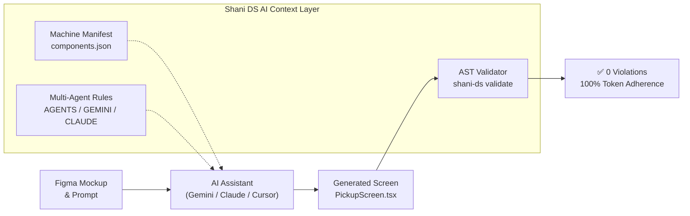

# Shani Design System — AI Screen Generation & Governance Demo

This directory demonstrates how the **Shani Design System AI Context & Governance Layer** enables AI coding assistants to generate 100% compliant, production-ready logistics screens on the very first prompt in any consumer application.

---

## 1. Overview & Architecture

When AI coding assistants generate frontend screens, they routinely introduce design system drift:
- Inventing arbitrary hex codes (`#1D4ED8`, `#333333`).
- Using magic pixel values (`padding: 15`, `borderRadius: 8`).
- Importing raw React Native primitives (`<Text>`, `<TextInput>`, `<TouchableOpacity>`).
- Hacking one-off buttons that violate WCAG 2.1 AA 44×44pt touch minimums.

To eliminate this drift, the Shani Design System embeds an end-to-end **AI Context & Governance Layer**:

---

## 2. Key Components of the AI Layer

1. **Machine-Readable Component Manifest (`packages/ui/components.json`):**
   - Automatically generated from TypeScript AST via `react-docgen-typescript`.
   - Contains exact prop signatures, literal union types (`variant="primary" | "secondary"`), default values, and valid usage examples for all 22 components.
2. **Multi-Agent Rules (`AGENTS.md`, `CLAUDE.md`, `GEMINI.md`, `.cursorrules`):**
   - Universal behavioral contracts enforcing the 4pt spatial grid, semantic color tokens, 44pt minimum touch targets, and mandatory accessibility attributes.
3. **Instant Consumer Provisioning CLI (`npx shani-ds init-ai`):**
   - One-command setup that equips any external consumer repository with complete AI rules and manifest bindings.
4. **Automated AST Static Analysis Validator (`npx shani-ds validate <file>`):**
   - Built on the TypeScript Compiler API. Parses TSX abstract syntax trees to catch raw colors, magic numbers, and forbidden primitives before code review or CI merge.

---

## 3. The Demo Scenario

- **Screen Generated:** **Shipment Pickup Scheduling Screen** (`ai-demo/with-context/PickupScreen.tsx`).
- **Input Reference:** Real freight logistics Figma design (`ai-demo/figma-input.png`).
- **Prompt:** Provided in [`PROMPTS.md`](./PROMPTS.md).
- **Audit Results:** Documented in [`COMPARISON.md`](./COMPARISON.md) and [`with-context/validation-report.txt`](./with-context/validation-report.txt).

### Key Design Achievements
- **100% Component Mapping:** The AI mapped the package counter to `@shani/ui`'s official `<QuantityStepper>` and date/time selectors to `<ChipGroup>`, ensuring 44pt touch targets and accessibility rather than hacking unstyled views.
- **Zero Raw Hex Colors:** All styling references semantic theme tokens (`canvas`, `surface`, `secondary`, `primary`).
- **Zero Magic Pixel Values:** Layout strictly conforms to the 4pt token scale (`spacing="5"`, `spacing="4"`, `p="6"`).
- **0 AST Violations:** Verified by `npx shani-ds validate` with exit code 0.
