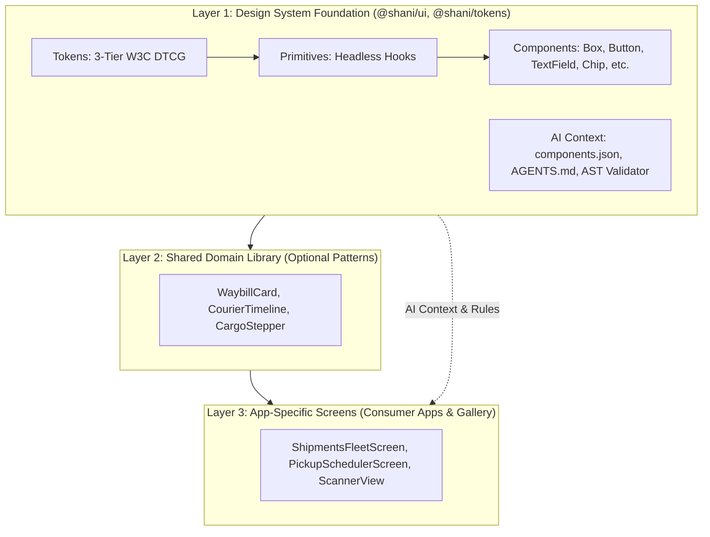

# Shani DS Architecture & Component Layering

Shani Design System follows a strict 3-tier layering model to keep foundation primitives reusable while scaling logistics applications.

### The Three Architectural Layers

1. **Layer 1 — Design System Foundation (`@shani/tokens`, `@shani/ui`):** Zero domain logic. Provides W3C DTCG design tokens, headless accessibility primitives (`useSelection`, `useCounter`, `usePressable`), and core UI components. Ships packaged AI context (`components.json`, rules, validator CLI) directly inside the npm package.
2. **Layer 2 — Shared Domain Library (Optional Domain Composites):** Reusable logistics patterns combining Layer 1 primitives with supply-chain entities (e.g. Waybill cards, route summaries).
3. **Layer 3 — App-Specific Code (Mobile Screens & Features):** End-user applications (Driver App, Warehouse Scanner, Gallery Demos). Built exclusively by composing Layer 1/2 components.

### Placement Rule
If a component contains domain concepts (waybills, manifests, drivers), it belongs in Layer 2 or 3. If it is generic and domain-agnostic with headless accessibility contracts, it belongs in Layer 1. The demo screens in this repository (`apps/gallery/app/demos/`) serve as production Layer 3 references constructed entirely from Layer 1 foundation components.
